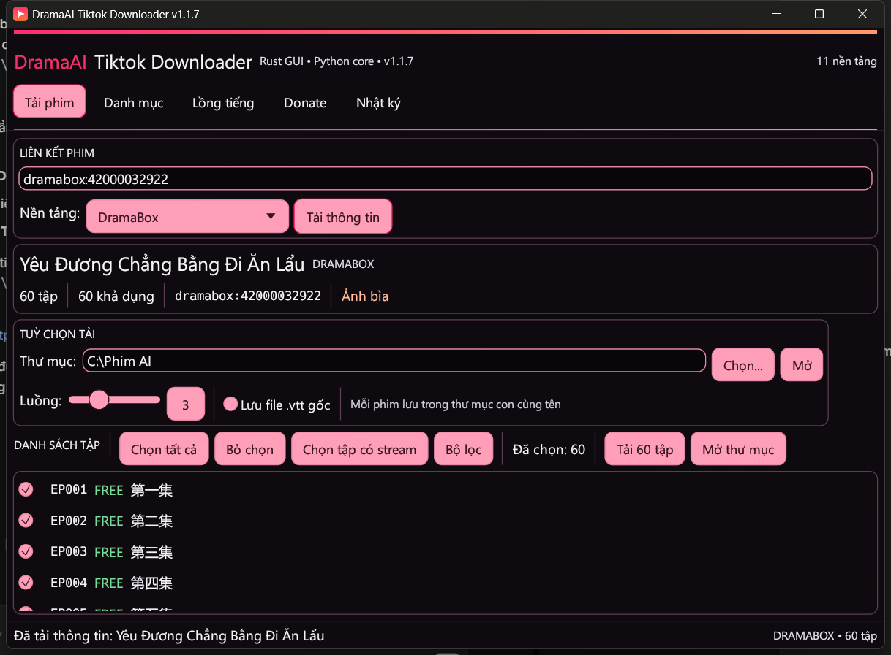
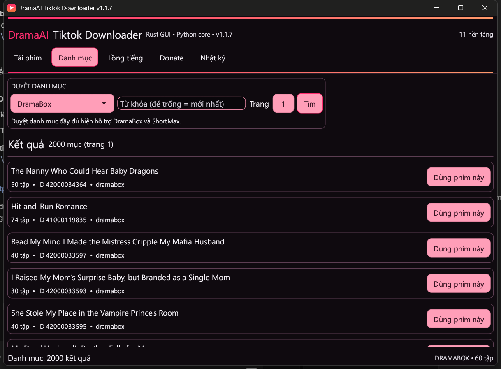
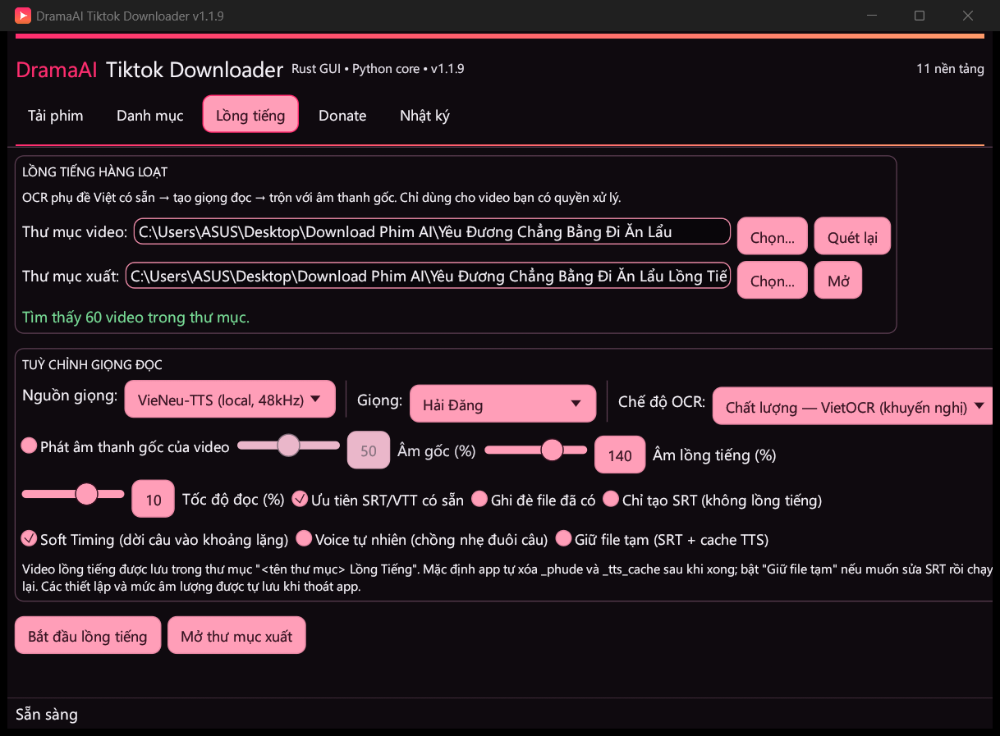
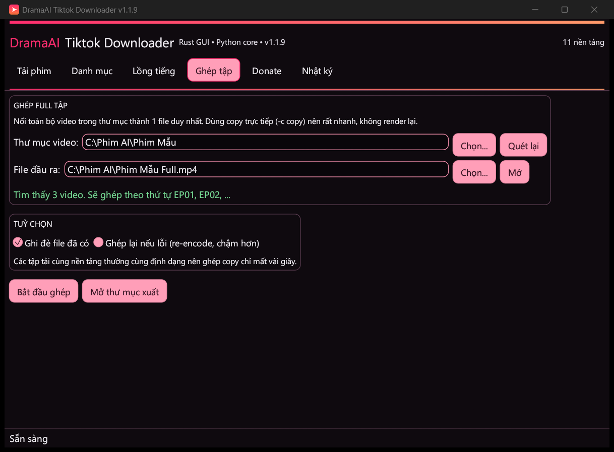
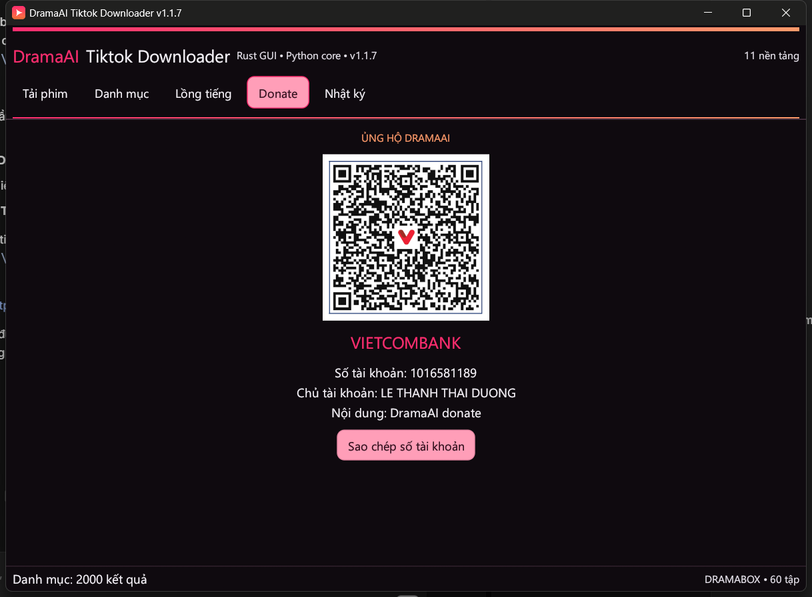
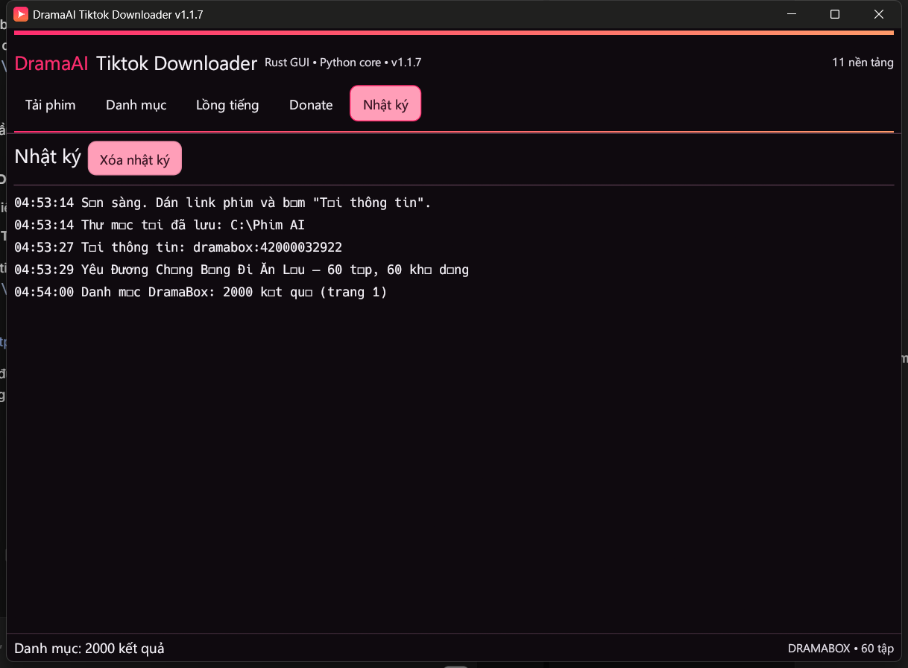
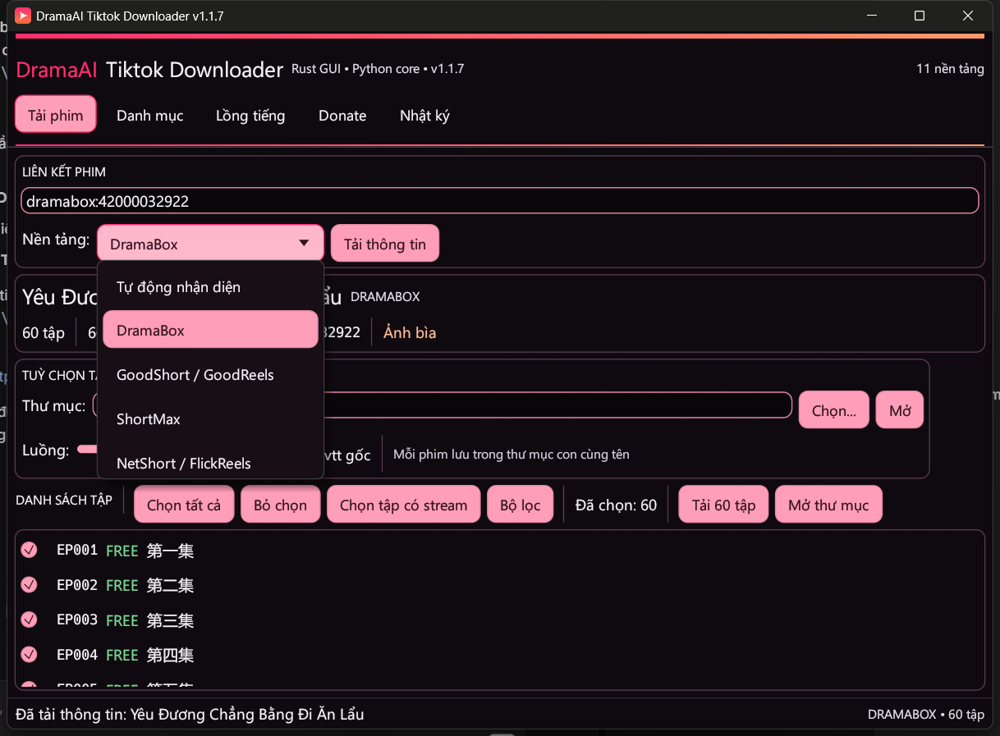

# DramaAI Tiktok Downloader — Rust GUI

<p align="center">
  
  
</p>
<p align="center">
  
  
</p>
<p align="center">
  
  
</p>
<p align="center">
  
</p>

Giao diện desktop native viết bằng **Rust + egui/eframe**. Phần giao diện và quản lý tiến trình nằm trong Rust; phần bóc tách dữ liệu, giải mã và tải file dùng lại lõi Python hiện có thông qua một bridge JSON nhỏ.

Cách này giữ nguyên toàn bộ logic 11 nền tảng, đồng thời không cần viết lại thuật toán RSA/Spade hay API của từng nền tảng.

## Chạy nhanh

Từ thư mục gốc repo:

```bat
run_gui.bat
```

Hoặc chạy trực tiếp:

```bat
gui\target\release\DramaAI-Tiktok-Downloader.exe
```

Yêu cầu:

- Python 3.8+ trên `PATH` và đã cài package (`pip install -e .`).
- File `drama_downloader/bridge.py` nằm trong repo.
- Muốn dùng tab **Lồng tiếng**: cài thêm `pip install -e ".[dubbing]"`, torch CPU và ffmpeg trong `PATH`.
- Muốn dùng VieNeu-TTS local (25 giọng, 48 kHz): cài thêm `pip install -e ".[dubbing-vieneu]"` (Python 3.10+).
- Muốn dùng ZeroTTS local (8 giọng): cài thêm `pip install -e ".[dubbing-zerotts]"`.
- Muốn dùng gTTS miễn phí: cài thêm `pip install -e ".[dubbing-gtts]"`.
- Muốn dùng Google Cloud TTS: cài thêm `pip install -e ".[dubbing-google]"` và chọn file service-account JSON.
- ElevenLabs / OpenAI / Azure chỉ cần nhập API key trong tab Lồng tiếng.
- Không cần Rust nếu chỉ chạy bản đã build.

Nếu Python không nằm trên `PATH`, đặt biến môi trường `DRAMA_PYTHON`:

```bat
set DRAMA_PYTHON=C:\Python312\python.exe
run_gui.bat
```

## Tính năng

- Dán link hoặc Series ID, tự nhận diện nền tảng (hoặc chọn thủ công).
- Xem tên phim, nền tảng, số tập, mô tả, ảnh bìa.
- Danh sách tập có trạng thái `FREE` / `KHÓA` / `NO STREAM` / số phụ đề.
- Chọn tất cả, bỏ chọn, chỉ chọn tập có stream, lọc theo tên/số tập.
- Nhập dải tập kiểu `1-10,15,20`.
- Tải song song nhiều tập, chọn số luồng 1–8.
- Mỗi series tự động lưu vào thư mục con đúng tên phim, không lẫn với series khác.
- Thanh tiến trình tổng và tiến trình từng tập.
- Hủy giữa chừng (file `.part` có thể còn lại).
- Chọn thư mục tải bằng hộp thoại Windows, mở thư mục sau khi tải.
- Tab **Danh mục** để duyệt phim (DramaBox và ShortMax).
- Tab **Lồng tiếng**: chọn cả thư mục phim, OCR phụ đề Việt có sẵn, tạo TTS bằng **8 nguồn giọng** (Edge TTS, VieNeu-TTS 25 giọng, ZeroTTS 8 giọng, gTTS, ElevenLabs, OpenAI, Google Cloud, Azure), Soft Timing và Voice tự nhiên, rồi trộn với âm thanh gốc. Kết quả nằm trong thư mục `<tên phim> Lồng Tiếng`; mặc định tự xóa `_phude` và `_tts_cache` sau khi xong.
- Tab **Ghép tập**: chọn thư mục phim, nối toàn bộ tập thành 1 file full duy nhất bằng `ffmpeg concat -c copy` — không render lại, chạy rất nhanh.
- Tab **Donate** với mã VietQR, thông tin Vietcombank và nút sao chép nhanh.
- Tab **Nhật ký** ghi lại từng bước và lỗi.
- Giao diện tông hồng–cam lấy cảm hứng từ DramaBox, cửa sổ tự căn giữa khi mở.
- Tự động lưu **toàn bộ thiết lập** — thư mục tải, số luồng, VTT, nền tảng, URL, thư mục lồng tiếng, nguồn giọng, giọng đọc, mức âm gốc/âm lồng, tốc độ đọc, OCR mode, Soft Timing, Voice tự nhiên, Giữ file tạm, API key/region/credentials và checkbox — vào:
  `%APPDATA%\DramaAI Tiktok Downloader\settings.json`.
- Không bundle `device.json`/`fix_shark` của CapCut; dùng Edge TTS hoặc VieNeu-TTS (mã nguồn mở) thay thế.
- Icon riêng và shortcut Desktop (`create_shortcut.ps1`).

## Kiến trúc

```text
┌─────────────────────────────┐
│  Rust GUI (eframe/egui)     │
│  - nhập URL, chọn tập       │
│  - tiến trình, log, hủy     │
└──────────────┬──────────────┘
               │ JSON qua stdin/stdout
               │ (mỗi dòng là một event)
┌──────────────▼──────────────┐
│  drama_downloader/bridge.py │
│  - load_series()            │
│  - DramaDownloader          │
│  - get_catalog()            │
└──────────────┬──────────────┘
               │
┌──────────────▼──────────────┐
│  Lõi Python hiện có         │
│  11 platform + crypto       │
└─────────────────────────────┘
```

Bridge nhận một request JSON từ stdin và ghi các event JSON ra stdout:

```json
{"cmd": "info", "target": "https://...", "platform": null}
{"event": "series", "series": {"name": "...", "episodes": [...]}}
```

Các event tải:

```json
{"event": "episode_start", "num": 1, "title": "..."}
{"event": "progress", "num": 1, "percent": 42.5, "downloaded": 123, "total": 456, "speed": 789}
{"event": "episode_done", "num": 1, "path": "..."}
{"event": "episode_error", "num": 1, "message": "..."}
{"event": "finished", "ok": 10, "failed": 0, "elapsed": 12.3}
```

Các event lồng tiếng:

```json
{"event": "dub_start", "total": 60, "folder": "...", "output_dir": "..."}
{"event": "dub_video_start", "index": 1, "total": 60, "name": "EP01.mp4"}
{"event": "dub_progress", "index": 1, "name": "EP01.mp4", "stage": "ocr", "percent": 42.0, "message": "OCR 42/112"}
{"event": "dub_video_done", "index": 1, "name": "EP01.mp4", "output": "...", "skipped": false}
{"event": "dub_video_error", "index": 1, "name": "EP01.mp4", "message": "..."}
{"event": "dub_finished", "done": 60, "failed": 0, "total": 60, "elapsed": 8231.5}
```

## Build từ source

Yêu cầu Rust với toolchain GNU trên Windows:

```powershell
# Cài rustup (một lần)
# Tải rustup-init.exe cho x86_64-pc-windows-gnu từ static.rust-lang.org
rustup-init.exe -y --profile minimal --default-host x86_64-pc-windows-gnu

# Build GUI
powershell -ExecutionPolicy Bypass -File gui\build.ps1
```

Script sẽ tự tải binutils tối thiểu từ MSYS2, tạo shim `dlltool` (do Rust windows-gnu truyền `--temp-prefix` có dấu `:` không hợp lệ trên Windows), rồi build release.

Tạo shortcut ngoài Desktop (có icon riêng):

```powershell
powershell -ExecutionPolicy Bypass -File create_shortcut.ps1
```

Hoặc double-click `Create Desktop Shortcut.bat` ở thư mục gốc repo.

Nếu bạn dùng toolchain MSVC + Visual Studio Build Tools, chỉ cần:

```powershell
cd gui
cargo build --release
```

## Smoke test không mở cửa sổ

Dùng để kiểm tra nhanh Rust → Python → dữ liệu series:

```powershell
$env:DRAMA_GUI_SMOKE = "https://www.dramaboxdb.com/movie/42000032672/drama"
gui\target\debug\DramaAI-Tiktok-Downloader.exe
# SMOKE_OK platform=dramabox episodes=70 selected=70
```

Chỉ bản debug in được kết quả ra console; bản release dùng Windows subsystem.

## Giới hạn hiện tại

- Cần Python và repo Python đi kèm; GUI chưa đóng gói thành một file exe độc lập.
- Tên app là thương hiệu **DramaAI Tiktok Downloader**; lõi hiện hỗ trợ 11 nền tảng phim ngắn OTT, chưa có extractor riêng cho video TikTok.
- Chưa xử lý HLS/m3u8: nếu API trả playlist `.m3u8`, file tải về sẽ là playlist chứ không phải video hoàn chỉnh.
- `catalog` chỉ có dữ liệu đầy đủ ở DramaBox và ShortMax.
- Hủy tải sẽ dừng tiến trình Python ngay, có thể để lại file `.part`.
- Phụ đề chỉ được bóc tách ở NetShort và FreeReels (giới hạn của lõi Python hiện tại).
- Việc tải nội dung có bản quyền là trách nhiệm của người dùng; xem disclaimer ở README gốc.

## Xử lý sự cố

| Lỗi | Cách xử lý |
|---|---|
| `Không chạy được Python` | Cài Python 3.8+, thêm vào PATH, hoặc đặt `DRAMA_PYTHON`. |
| `Không tìm thấy bridge Python` | Chạy exe từ trong repo, hoặc đặt `DRAMA_ROOT` trỏ tới thư mục gốc. |
| Chữ Trung/Nhật bị ô vuông | Cài font Microsoft YaHei (`C:\Windows\Fonts\msyh.ttc`). |
| Build lỗi `dlltool` | Chạy `gui\build.ps1` để tạo shim, hoặc dùng toolchain MSVC. |
